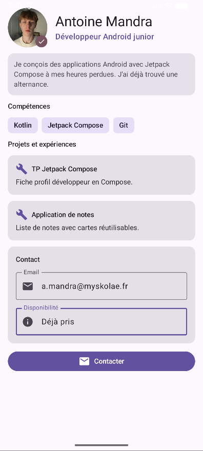

# Profil développeur – Amélioration UI

## Description

Application Android qui affiche la fiche profil d'un développeur junior (Antoine Mandra) : nom, rôle, courte description, photo de profil, compétences, projets, zone de contact et un bouton d'action « Contacter ».
Les données sont écrites directement dans le code Kotlin (`MainActivity.kt`). Aucune API, aucun stockage local.

## Composants Compose utilisés

- `Text` : titres, description, compétences, libellés
- `Button` : action principale « Contacter » (callback vide)
- `Icon` : icônes des champs de contact, de la carte projet et du badge
- `Image` : photo de profil (avatar, `res/drawable/avatar.jpg`)
- `Card` : cartes des projets et de la zone de contact
- `OutlinedTextField` en lecture seule (`readOnly = true`) : email et disponibilité
- `Surface` : zone de description, puces de compétences, badge

## Layouts utilisés

- `LazyColumn` : structure verticale de tout l'écran
- `LazyRow` : liste horizontale des compétences
- `Column` : organisation verticale à l'intérieur des cartes et de l'en-tête
- `Row` : avatar et nom sur une même ligne, icône et titre d'un projet
- `Box` : avatar superposé au badge
- `Spacer` : espaces entre l'icône et le texte
- `Surface` : zones visuelles colorées (description, puces, badge)

## Liste affichée avec LazyColumn et LazyRow

L'écran entier est une `LazyColumn` : chaque élément (en-tête, description, titre de section, liste, cartes, bouton) est un `item` ou un groupe `items`. Les projets sont affichés avec `items(projets) { ProjectCard(...) }`, où `ProjectCard` est un composable réutilisable qui reçoit un objet `Projet` (titre et description).

Les compétences sont affichées dans une `LazyRow` (`items(competences) { TechnologyChip(...) }`), ce qui permet de les faire défiler horizontalement. Chaque puce est un composable réutilisable.

## Choix de thème

- Les couleurs viennent du `colorScheme` défini dans `ui/theme/Theme.kt` (thème clair et thème sombre), avec la palette violette du projet.
- Les couleurs dynamiques (Android 12+) sont désactivées (`dynamicColor = false`) pour garder une identité visuelle identique sur tous les appareils.
- Les formes viennent de `MaterialTheme.shapes` (`AppShapes` : coins de 8, 12 et 16 dp).
- Les textes utilisent `MaterialTheme.typography` (`headlineMedium`, `titleMedium`, `titleSmall`, `bodyMedium`, `labelLarge`).
- Trois previews : deux profils en thème clair et un en thème sombre (`uiMode = UI_MODE_NIGHT_YES`).

## Capture d'écran

## Quelles notions du chapitre Compose UI avez-vous réutilisées ?

J'ai réutilisé les composants fondamentaux (`Text`, `Button`, `Icon`, `Image`, `Card`, `TextField` en lecture seule), les layouts (`Column`, `Row`, `Box`, `Spacer`, `Surface`), une liste moderne (`LazyColumn` et `LazyRow`) avec des composables réutilisables, ainsi que Material Design 3 (`colorScheme`, `typography`, `shapes`) avec les thèmes clair et sombre.
